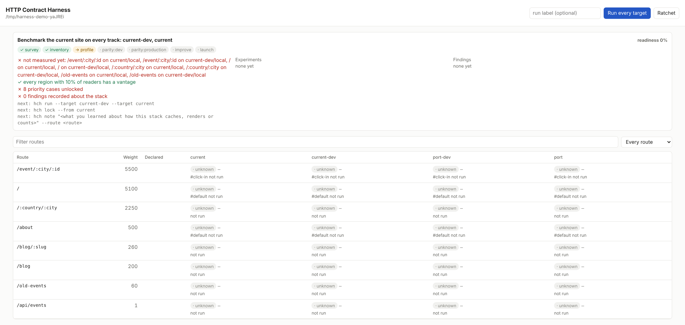
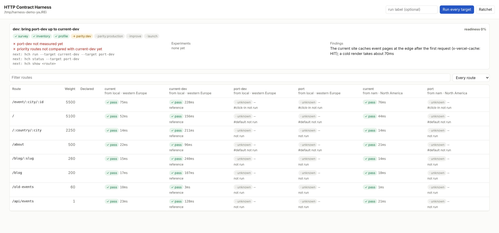
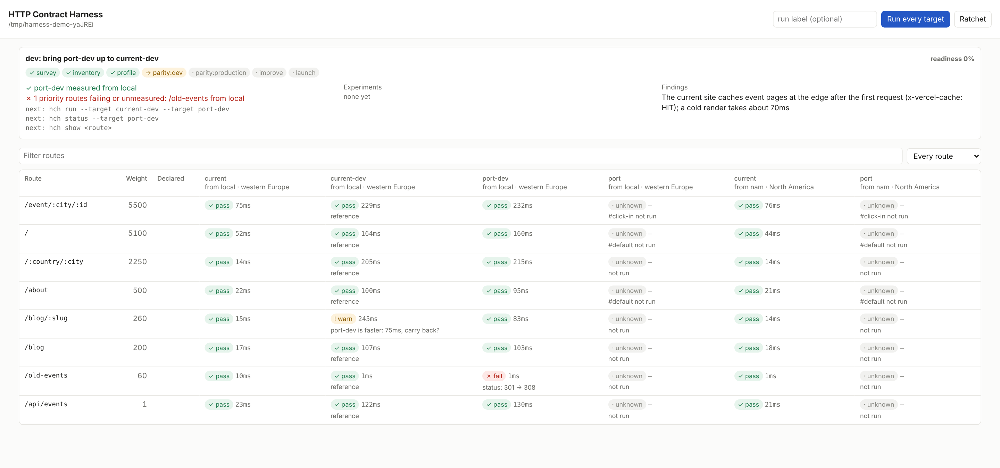
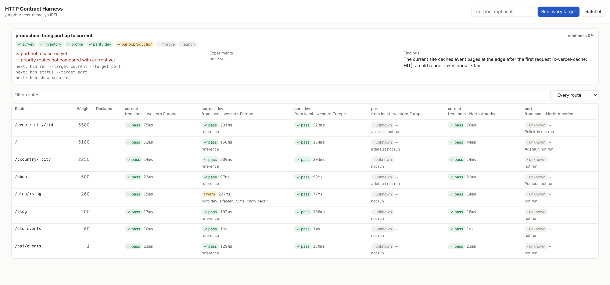
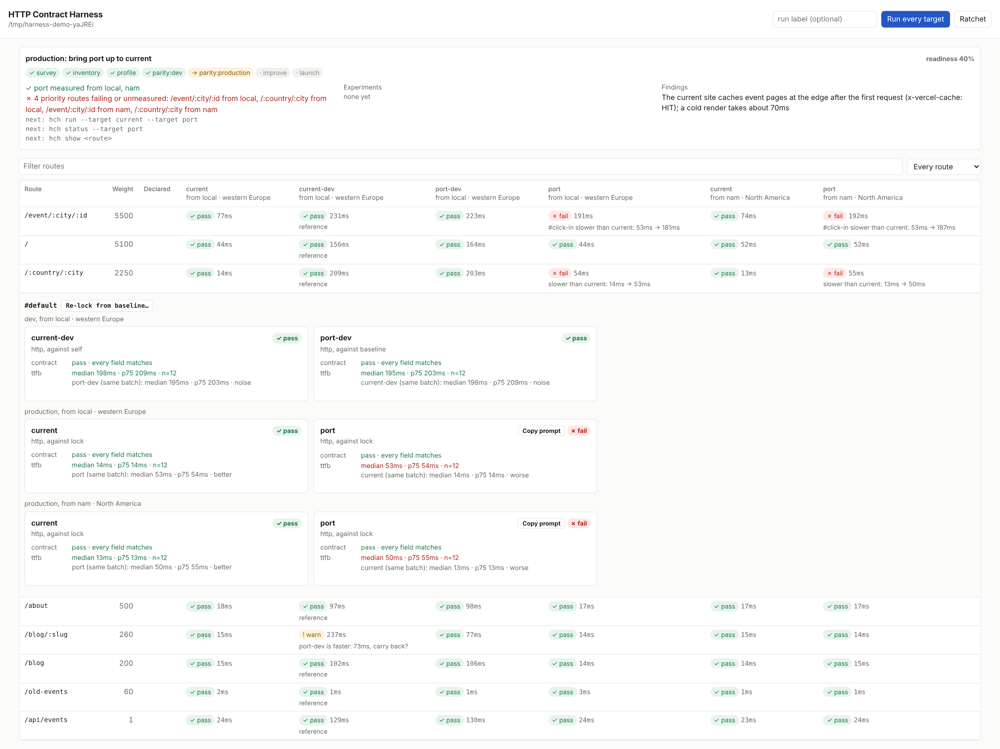
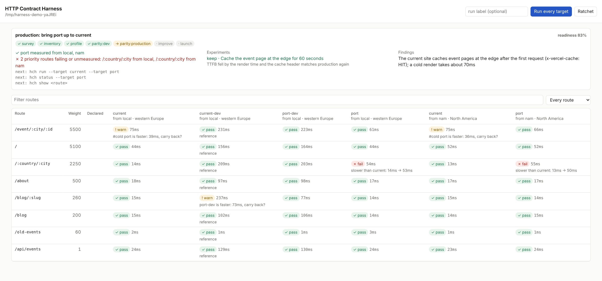
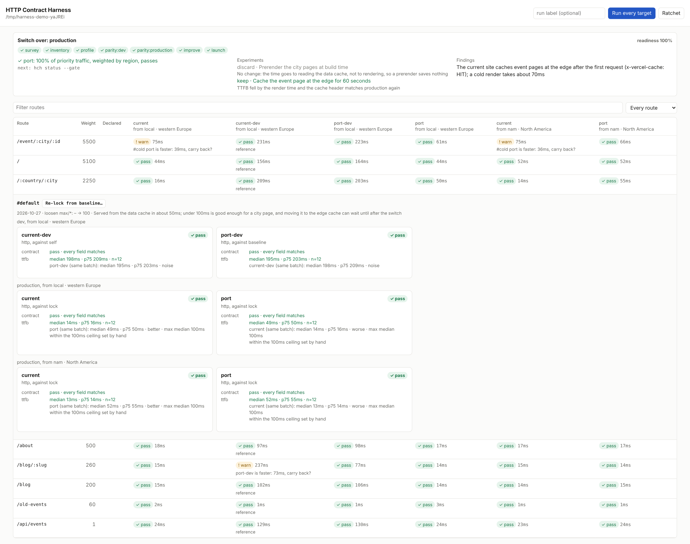

# HTTP contract harness

The record and the method for porting a website route by route.

A port moves a site to a new framework, a new host, or both, and the question at every step is
whether each route still does what it did, as fast as it did, for the readers who use it. The harness
keeps the answer. It holds an inventory of the site's routes, every measurement ever taken of
them, the contract the port is held to, the experiments tried and what was decided, and what was
learned along the way. It judges every measurement the same way, and it says which phase of the
port you are in and what comes next.

What it does not do is decide how to measure. How a page load is counted, what a cold cache means,
how a cache is purged, when a client-side navigation has finished: those depend on the site and
its stack, and the answers for Next.js on Vercel are not the answers for TanStack Start on
Cloudflare. They live in **probes**, small modules in your repository that you or your agent write,
read and change. Where traffic numbers come from lives in **sources**, written the same way.
The harness starts you with working examples of both.

## Install

The harness needs Node 22.13 or later. It is not on npm yet; build it from this repository:

```sh
git clone https://github.com/mhsnook/http-contract-harness && cd http-contract-harness
pnpm install && pnpm build
pnpm link --global
```

Browser probes need `playwright-core` installed next to it, and a Chromium.

## Try it

```sh
hch demo
```

The demo starts four small simulated sites on this machine: a current site in production and in
dev mode, and its port in dev mode and deployed. It walks through every phase below with the real
CLI, deploys two fixes along the way by flipping switches on the simulated port, and leaves the
dashboard and the sites running so you can carry on by hand. `--until profile` stops after a
phase; `--dir` keeps the project somewhere you choose.

## A port, stage by stage

These are the dashboard (`hch serve`) at seven points in `hch demo`. Each shows the plan, with its
phase strip, above every route on every target. A column is a target measured from a vantage:
`current` from `nam` is the current site in production, measured from a runner standing in for
North America. The sites are simulated and both
vantages run on one machine, so the numbers show how the method works, not how any host performs.

**1. Inventory.** The survey has weighted the routes by traffic, and nothing has been measured yet.



**2. Profile.** The current site is measured in production and in dev mode and locked. Its dev
server is the reference for the dev track. The port has not run.



**3. Dev parity, failing.** The port's dev server answers `/old-events` with a 308 where the current
site answers 301. Readers land there from old links, so it is a priority route, and the dev phase
waits for it. The port also renders blog posts faster, so the current site is asked to carry that
back.



**4. Dev parity, passing.** With the redirect fixed, the dev phase is ticked off and production is
next.



**5. Production parity, failing.** Deployed, the port has lost the edge cache on event pages and
serves city pages from a slower data cache. Two batches in a row agree, so both fail rather than
warn. The city page is open: one row per comparison, the current site on the left and the port on
the right, passing rows first. A failing card's Copy prompt button copies a prompt that asks an
agent to fix it.



**6. An experiment.** Caching the event page at the edge, measured before and after, is kept with
its reason. The event page turns green, and the port now beats the lock on a cold request.



**7. Good enough.** A second experiment, prerendering the city pages, changes nothing and is
discarded. A person decides 50 ms is good enough for a city page and sets a 100 ms ceiling with
`hch loosen --max 100 --reason "…"`. The case shows the decision and its reason, the route turns
green, and every phase is done.



## Start

```sh
cd your-site
hch init --current https://www.example.com --port https://port.example.com \
  --current-dev http://localhost:3000 --port-dev http://localhost:3001
hch plan
```

`init` writes `harness.config.json` and `harness.lock.json`, copies the starter probes into
`harness/probes/` and the starter sources into `harness/sources/`, installs the agent skill into
`.claude/skills/http-contract-harness/`, and ignores `.harness/`, where the measurements live.
`plan` says what to do next. Commit everything else.

Leave out the two dev URLs to compare production alone. `--no-skill` skips the skill.

### With an agent

The skill tells a coding agent such as Claude Code when the harness applies, to start every
session with `hch plan --json`, how to work each phase, and which commands need a person's
agreement first. Every command takes `--json`, so the agent reads results rather than scraping
them. An agent without skills can run `hch guide`, which prints the same method at length.

## The phases

`hch plan` works out where the port stands from the database, the lock and the ledger, and
lists the checks of the current phase and the commands that move it on.

1. **Survey.** Which routes readers view, which they land on from outside, and where they are.
   `hch survey` runs the project's sources (or reads `--csv` exports), stores the rows, ranks
   the routes by views and by entries, lists the traffic no route in the inventory covers, and
   works out the share of readers in each region. Route weights come from it, and the **priority
   routes** are the smallest set that holds 80% of the views and 80% of the entries.
2. **Inventory.** Every route, with sample URLs and the cases that reach it differently: a cookie,
   a header, a query string, a different probe. `hch discover` reads sitemaps, a Next.js build
   (`--next .next`) and the surveyed traffic (`--traffic`).
3. **Profile.** The current site measured on every priority route, on every track (usually dev
   mode and production), from a vantage in every region that holds a tenth of the readers. The
   production numbers are locked in as the contract with `hch lock`.
4. **Parity, one phase per track.** The port brought up to the current site on the priority
   routes: in dev mode first, against the current site's dev server, then deployed, against
   production and the lock.
5. **Improve.** Experiments on the routes that are slower than they should be, each one recorded
   with its theory, its before and after, and the decision.
6. **Launch.** Readiness is the share of priority traffic, weighted by region, whose routes pass.

### Tracks

A track pairs a target of the current site with the matching target of the port:

```json
"tracks": [
  { "name": "dev", "baseline": "current-dev", "port": "port-dev" },
  { "name": "production", "baseline": "current", "port": "port" }
]
```

Each port is judged against its own track's baseline, measured in the same batch. Only the track
whose baseline is the config's `baseline` is held to the lock, since dev servers render every
request and their numbers are not a contract. A target with `"options": { "purge": false }` keeps
no cache, so a cold case runs on it without a purge. A target listing `vantages` is measured only
from those, as a dev server on a laptop is reachable only from `local`.

## Probes

A probe is an ES module in `harness/probes/`. The harness calls it once per repeat, per target, and
keeps what it returns.

```js
export default {
  describe: "GET with redirects off",
  primary: "ttfb", // the metric the timing verdict reads
  fields: { cache: { policy: "if-slower", order: ["uncached", "cached"], optional: true } },
  async prepare(ctx) {}, // untimed, before each repeat: purge a cache, log in
  async measure(ctx) {
    const res = await ctx.request(ctx.path)
    return {
      metrics: { ttfb: res.ttfb, total: res.total },
      record: ctx.record(res), // the fields the contract compares
      served: ctx.servedFrom(res.headers), // where the platform says it answered
    }
  },
  summarise(samples, ctx) {}, // optional: fields that need every repeat, such as a cache verdict
}
```

`ctx` carries the target, the route and its sample, the case's `conditions`, `request()` (timed,
redirects off), `browser()` (a Playwright browser from the vantage), `exec()`, the contract
normaliser, cache-header and served-from helpers, and `state` that lasts across the repeats of a
batch. A sample can say `skip: "why"`, such as a purge that did not take, or `warmup: true`, such
as the request that filled a cache; neither is timed.

A probe's version is the hash of its file and every local module it imports. The harness never
compares numbers measured by two versions: a lock taken with an older version reads as stale until
the case is measured and locked again. Change how a probe counts, and the comparison starts over.

The starters, which are yours to change:

| Probe      | Measures                                                    | Primary      |
| ---------- | ----------------------------------------------------------- | ------------ |
| `http`     | a GET, warm, revalidating with the page's ETag, or cold     | `ttfb`       |
| `page`     | a browser loading the page, or reloading it warm            | `lcp`        |
| `navigate` | a browser clicking into the route from another page         | `navMs`      |
| `command`  | any command, such as a Playwright spec or a scenetest scene | `durationMs` |

Each starter opens with what it counts and which assumptions to revisit for another stack. For
example, `http` with `cache: "cold"` runs the target's `options.purge` command before each
request, because on vinext a unique query string does not reach the cache key.

## Cases and the contract

A case is one way of reaching a route: a probe, and the conditions it is given.

```sh
hch case add /event/:city/:id cold --probe http --condition cache=cold
hch case add /event/:city/:id nav --probe navigate --condition from=/
hch case add / es --cookie locale=es
```

A probe's `record` is the contract: status, `Location`, headers, whatever it chooses to return.
Each field has a policy, from the probe, the route or the case:

- `must-match`: any difference fails.
- `if-slower`: a difference fails only when the route is also slower; while it stays fast enough,
  it is a warning. A lost cache is the usual example.
- `ignore`: shown, never judged.

A field's `order` lists its values from worst to best, so `uncached → cached` is an improvement,
which `hch ratchet` keeps.

## Measuring

`hch run` measures every case on every target in one **batch** per vantage, requesting the
targets in turn, so both share the machine and the network. Timings are compared within a batch:
the middle halves of the two distributions have to separate, and the medians differ by 10% and
25 ms, before anything is called slower. A target slower than the baseline fails only when the
batch before agreed; the first time it is a warning. The baseline slower than another target is a
warning too, the cue to carry the port's change back. Timings from another batch only ever warn.

`hch lock` records the baseline's record and its timing per vantage. `ratchet` tightens what
a target now beats and never loosens. `loosen` is the one way down, and keeps its reason.

## Vantages

A vantage is where probes run. `local` is this machine. Any other machine can be one:

```sh
hch runner serve --token "$TOKEN" --region weur        # on a VM in Frankfurt, say
```

```json
"vantages": {
  "local": {},
  "fra": { "url": "https://runner-fra.example.com", "token": "${RUNNER_TOKEN}", "region": "weur",
           "browser": { "cdp": "wss://…" } }
}
```

The client sends the runner the probes' code and hashes; the runner checks each hash, runs the
batch and streams the results back. It executes what it is sent, so the token is its whole
security: run it behind HTTPS, and give the token only to people who could run code on that
machine anyway.

A vantage's `browser.cdp` can point at any Chrome DevTools endpoint, such as a Cloudflare Browser
Run session; every probe that asks for a browser then gets that one.

### Regions

`hch survey --regions` writes the share of readers per region into the config, in coarse
regions (`nam`, `sam`, `weur`, `eeur`, `me`, `afr`, `apac`, `oc`). The plan asks for a vantage in
each region that holds a tenth of the readers, and launch readiness weighs each vantage's results
by its region's share.

Where a vantage really is matters more than where it says it is, so probes report where each answer
was served (`cloudflare:FRA`, `vercel:fra1>iad1`) from the platforms' own headers. On Cloudflare
(checked on 2026-10-21): Browser Run takes no region parameter and opens sessions close to whatever
launches them; a Durable Object's `locationHint` (`wnam`, `enam`, `weur`, `eeur`, `apac`, `oc`) and a
Worker's `placement.region` both place code in a region, as a best effort, and neither documents
where its outbound requests or browsers come from. Check `served` before trusting a vantage's
region.

Probing a Cloudflare-hosted port from inside Cloudflare's network flatters it: the request never
crosses the internet, while the same probe to a site on another host does. Compare the two from a
vantage outside both platforms.

## Experiments and findings

```sh
hch experiment start "Cache the event page for 60s at the edge" --route /event
# make the one change and deploy it
hch experiment measure <id>
hch experiment decide <id> keep --why "TTFB 140ms faster from every vantage; events stay fresh enough"
hch note "vinext leaves the query string out of its page cache key" --route /event --tag cache
```

`start` lists what was already tried on those routes, and the findings about them, then measures a
before batch: the target and a reference, usually the baseline, from every vantage. `measure`
takes an after batch and corrects each case's change by what the reference did in between.
Keeping an experiment that broke the contract is refused. Experiments and findings live in
`harness.ledger.json`, which is committed, so the next person or agent sees what was tried, what
was learned, and why.

## Commands

`hch help` lists them all, and every command takes `--json`. `hch prompt` prints, for each case
that fails or warns, a prompt to hand an agent: what differs, what it is held to, and how to check a
fix. The dashboard's Copy prompt buttons copy the same text. `hch status --gate` exits 1
when any route fails, for CI. `hch serve` opens a dashboard that follows the database, the
lock and the ledger as they change, whoever changes them.

## Limits

- Probes measure from where they run. A browser probe measures one Chromium, not your readers'
  devices; the platforms' own analytics say what readers got.
- The starter sources (Plausible, Cloudflare, Vercel) were written from each platform's
  documentation and have not been run against a real account. They start switched off.
- Only what the probes do is done. The starters make only `GET` requests.

## Development

```sh
pnpm install
pnpm test        # unit tests, the whole loop against two fixture sites, a browser, a remote runner
pnpm typecheck
pnpm build
pnpm format
node scripts/screenshots.mjs   # retake docs/screenshots from a run of the demo (after pnpm build)
```

[docs/design.md](docs/design.md) records why it works the way it does.
